

# COMFORT Série 300 — Calculateur

### حاسبة قطع الألمنيوم · Calepinage & débit aluminium · Aluminium cutting calculator

**Aluminium du Maroc · V6.0**

[🇲🇦 العربية](#-العربية) &nbsp;·&nbsp; [🇫🇷 Français](#-français) &nbsp;·&nbsp; [🇬🇧 English](#-english)

 

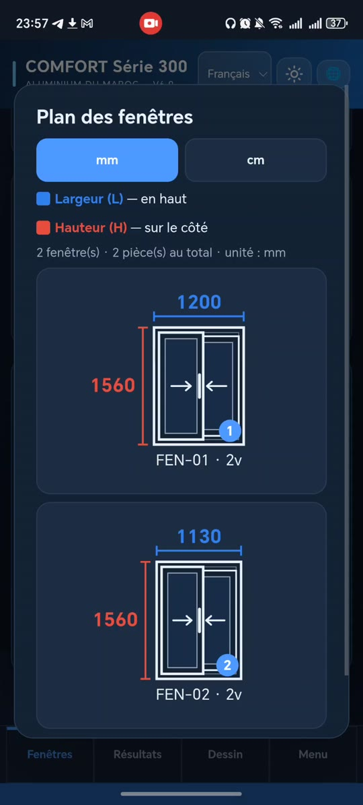
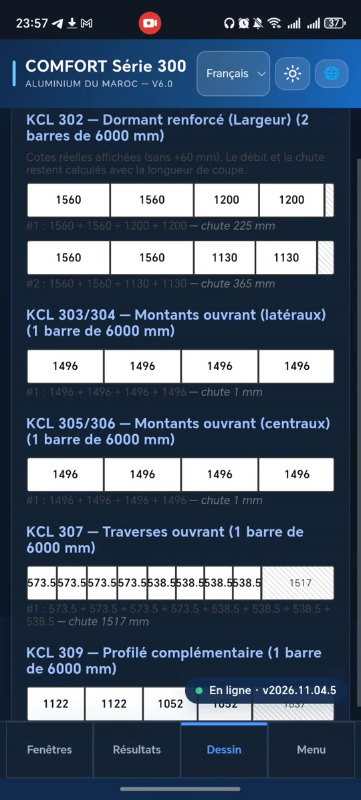
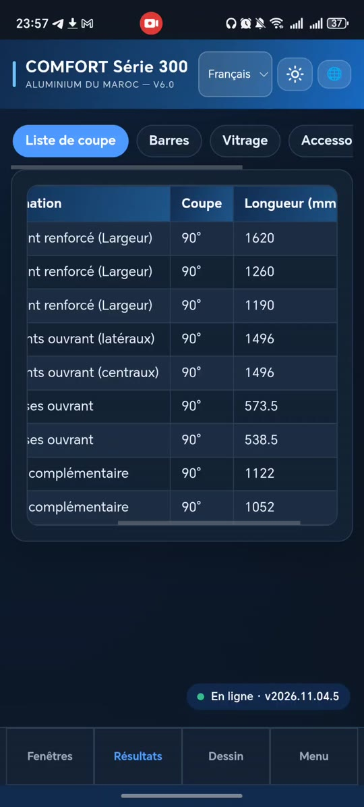

---

# 🇲🇦 العربية

**الفهرس:** [نظرة عامة](#ar-overview) · [المميزات](#ar-features) · [لقطات الشاشة](#ar-shots) · [طريقة الاستعمال](#ar-usage) · [الواجهة](#ar-ui) · [الإضافات](#ar-ext) · [بنية المستودع](#ar-repo)

## 📖 نظرة عامة

**COMFORT Série 300 — Calculateur** تطبيق ويب تقدّمي (PWA) مصمَّم للهاتف، لحساب قطع الألمنيوم في نجارة النوافذ من نوع **COMFORT Série 300** (ألمنيوم المغرب). تُدخل مقاسات النوافذ فيحسب التطبيق أطوال كل بروفيل، ويوزّع القطع على أعمدة طولها 6000 مم لتقليل الفضلات، ثم يرسم مخطط التقطيع ويصدّر التقارير الجاهزة للورشة.

> 🔗 **جرّب التطبيق الآن:** [https://king-dak.github.io/comfort-serie-300/](https://king-dak.github.io/comfort-serie-300/)

## ✨ المميزات

| | الميزة | التفاصيل |
|:--:|---|---|
| 🌐 | **ثلاث لغات** | الفرنسية والإنجليزية والعربية، تُختار عند أول تشغيل ومن الشريط العلوي |
| 🌗 | **وضعان** | فاتح وداكن |
| 📚 | **كتالوج السلاسل** | السلاسل والشركات، ونظام **Coulissant 2 vantaux / 2 rails** (صفحات الكتالوج 9 و11 و13 و15) |
| 🧮 | **حساب الإطار (Dormant)** | عدة أنماط منها **Mixte** لضبط البروفيلات (KCL 301 / KCL 302) لكل جهة وكل نافذة |
| 📏 | **إدخال مرن** | مم / سم / م — العرض (L) والارتفاع (H) والكمية — إضافة، تعديل، تكرار، حذف |
| ⚙️ | **إعدادات القص** | طول العمود (6000 مم افتراضيًا) وهامش القص (5 مم افتراضيًا) |
| 📐 | **مخطط النوافذ** | رسم مُقاس: العرض في الأعلى والارتفاع على الجانب |
| ✂️ | **تقطيع الأعمدة** | رسم توزيع القطع على الأعمدة مع الفضلة (chute) لكل عمود |
| 📊 | **النتائج** | قائمة القص، الأعمدة، الزجاج، الإكسسوارات |
| 📤 | **التصدير** | تقرير PDF، رسم القص PDF، وملفات CSV (قائمة القص، الأعمدة، الزجاج، الإكسسوارات) |
| 💰 | **الأسعار والقواعد** | أسعار البروفيلات (درهم/كغ) وقواعد القص الرسمية القابلة للتعديل |
| 💾 | **المشاريع** | حفظ المشروع في ملف وإعادة فتحه |
| 🧩 | **الإضافات** | تثبيت إضافات تعمل دون إنترنت، واستيراد إضافة من ZIP في مساحة معزولة |

## 📸 لقطات الشاشة

<table>
<tr>
<td align="center" width="33%"> <b>القائمة الرئيسية</b></td>
<td align="center" width="33%">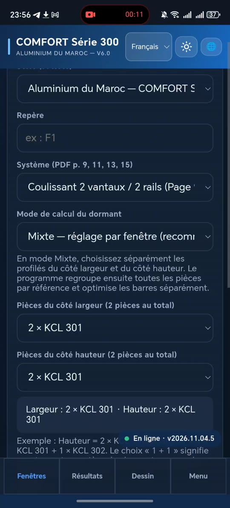 <b>النظام وطريقة الحساب</b></td>
<td align="center" width="33%">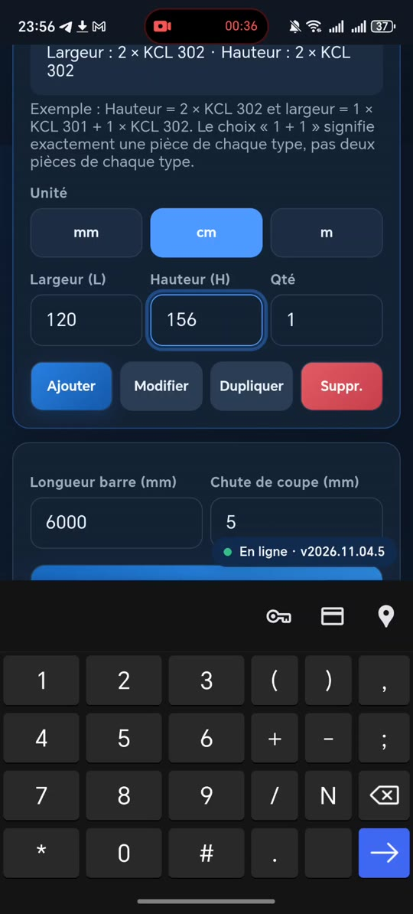 <b>إدخال المقاسات</b></td>
</tr>
<tr>
<td align="center" width="33%">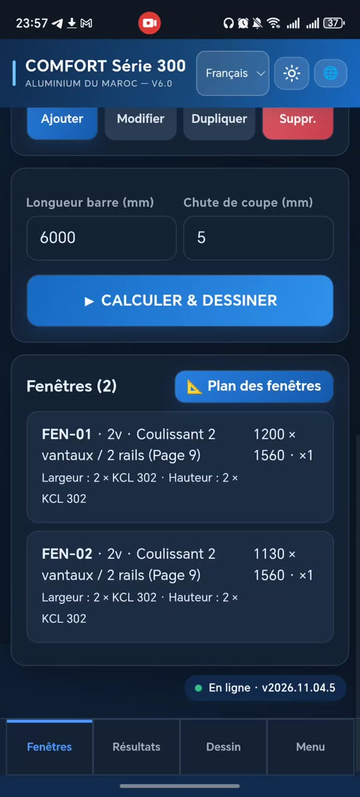 <b>قائمة النوافذ</b></td>
<td align="center" width="33%"> <b>مخطط النوافذ</b></td>
<td align="center" width="33%"> <b>رسم تقطيع الأعمدة</b></td>
</tr>
<tr>
<td align="center" width="33%"> <b>قائمة القص</b></td>
<td align="center" width="33%"> <b>التصدير PDF / CSV</b></td>
<td align="center" width="33%"> <b>القواعد والإضافات والإدارة</b></td>
</tr>
</table>

## 🚀 طريقة الاستعمال

1. افتح التطبيق واختر اللغة.
2. في تبويب **Fenêtres** اختر النظام وطريقة حساب الإطار.
3. أدخل **العرض** و**الارتفاع** و**الكمية** ثم اضغط **Ajouter**. مثال: `1200 × 1560` و`1130 × 1560`.
4. راجع طول العمود وهامش القص، ثم اضغط **CALCULER & DESSINER**.
5. اطّلع على **Résultats** (قائمة القص، الأعمدة، الزجاج، الإكسسوارات) وعلى **Dessin** (رسم التقطيع).
6. من **Menu** صدّر PDF أو CSV، أو احفظ المشروع.

## 🧭 الواجهة

| التبويب | الوظيفة |
|---|---|
| **Fenêtres** | إعداد النظام وإدخال النوافذ والحساب |
| **Résultats** | قائمة القص — الأعمدة — الزجاج — الإكسسوارات |
| **Dessin** | رسم تقطيع كل بروفيل (KCL 302، 303/304، 305/306، 307، 309 …) |
| **Menu** | مشروع جديد، حفظ/فتح، تقارير PDF، CSV، الأسعار، القواعد، الإضافات، الإدارة، حول |

## 🧩 الإضافات (Extensions)

يتيح **Extensions Manager** تثبيت الإضافات وتحديثها واستيرادها من ZIP. الإضافات المثبّتة تُحفظ على الجهاز وتعمل دون إنترنت.

| الإضافة | المعرّف | الإصدار | الوصف |
|---|---|---|---|
| **AluHub** — مركز الألمنيوم (فيديو · أخبار) | `ma.comfort300.aluhub` | 2.2.1 | فيديوهات وروابط وأخبار داخل الإضافة، وتحديث تلقائي من مصدر JSON |
| **PanelCut** — حاسبة ألواح الخشب والفورميكا والزجاج | `ma.comfort300.panelcut` | 1.1.0 | مخططات قص دقيقة لكل لوح، حساب الهدر والتكلفة، وتقرير PDF |

<table>
<tr>
<td align="center" width="33%">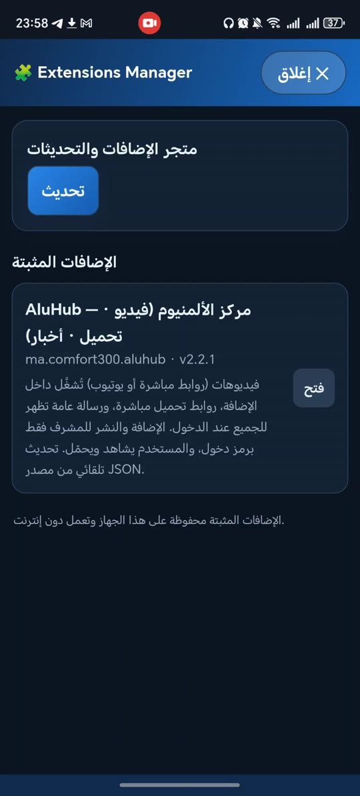 <b>مدير الإضافات</b></td>
<td align="center" width="33%">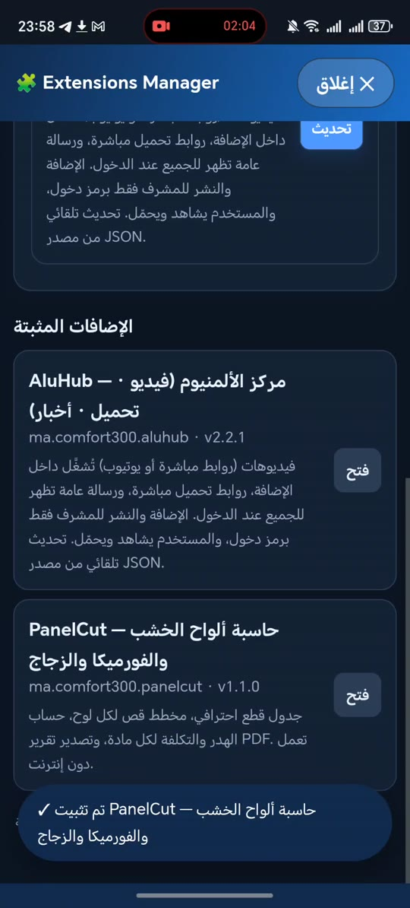 <b>الإضافات المثبّتة</b></td>
<td align="center" width="33%">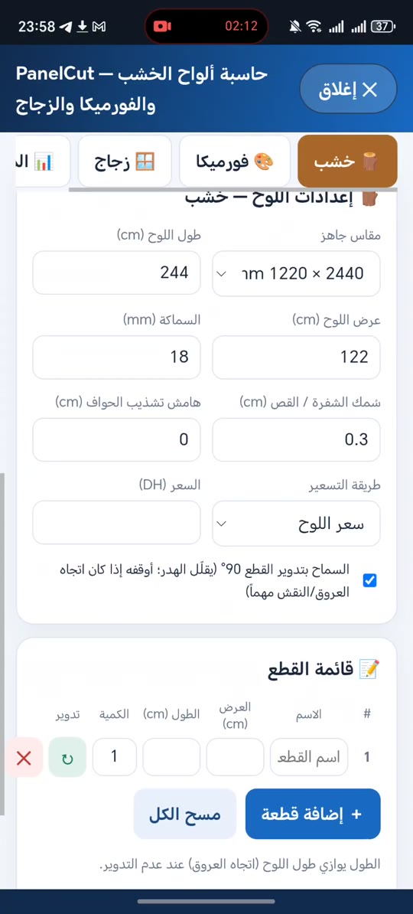 <b>PanelCut — إعدادات اللوح</b></td>
</tr>
<tr>
<td align="center" width="33%">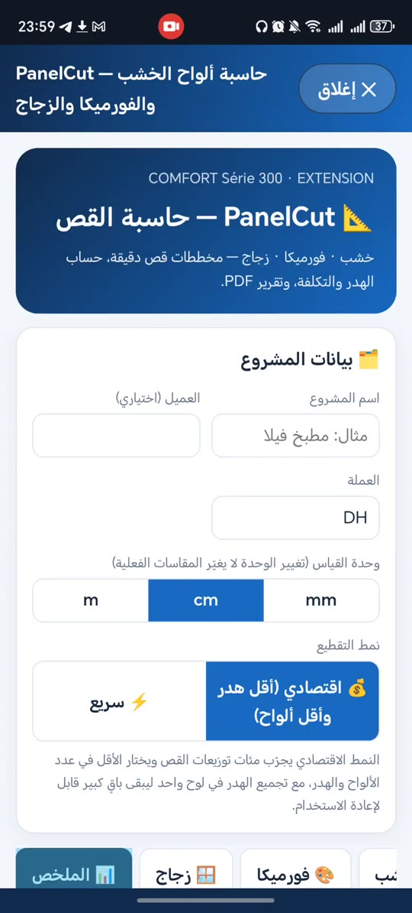 <b>PanelCut — المشروع ونمط القص</b></td>
<td align="center" width="33%"> <b>PanelCut — قائمة القطع</b></td>
<td align="center" width="33%">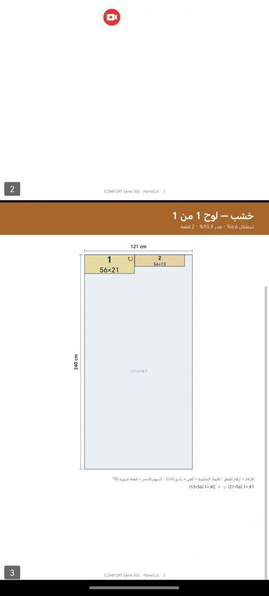 <b>PanelCut — تقرير PDF</b></td>
</tr>
</table>

## 📂 بنية المستودع

| الملف | الدور |
|---|---|
| `index.html` | التطبيق الرئيسي |
| `manifest.webmanifest` · `sw.js` · `icon-*.png` · `icon.svg` | ملفات PWA (التثبيت على الهاتف والعمل دون إنترنت) |
| `extensions.js` · `extensions/` · `registry.json` | نظام الإضافات وسجلّها |
| `panelcut-extension.zip` · `smartcut-extension.zip` · `hello-extension.zip` | حزم إضافات جاهزة |
| `version.json` | رقم الإصدار |
| `comfort-guide.html` | دليل الاستعمال |
| `LISEZ-MOI.txt` · `README_AR.txt` | شروحات نصية (فرنسي / عربي) |

---

# 🇫🇷 Français

**Sommaire :** [Présentation](#fr-overview) · [Fonctionnalités](#fr-features) · [Captures](#fr-shots) · [Utilisation](#fr-usage) · [Interface](#fr-ui) · [Extensions](#fr-ext) · [Structure](#fr-repo)

## 📖 Présentation

**COMFORT Série 300 — Calculateur** est une application web progressive (PWA) pensée pour le mobile, qui calcule les profilés aluminium des menuiseries **COMFORT Série 300** (Aluminium du Maroc). On saisit les dimensions des fenêtres ; l'application calcule la longueur de chaque profilé, répartit les pièces sur des barres de 6000 mm pour limiter les chutes, dessine le plan de coupe et produit des rapports prêts pour l'atelier.

> 🔗 **Essayer l'application :** [https://king-dak.github.io/comfort-serie-300/](https://king-dak.github.io/comfort-serie-300/)

## ✨ Fonctionnalités

| | Fonction | Détails |
|:--:|---|---|
| 🌐 | **Trois langues** | Français, anglais, arabe — choix au premier lancement et dans la barre du haut |
| 🌗 | **Thèmes** | Clair et sombre |
| 📚 | **Catalogue** | Séries et sociétés, système **Coulissant 2 vantaux / 2 rails** (pages 9, 11, 13, 15 du catalogue) |
| 🧮 | **Calcul du dormant** | Plusieurs modes, dont **Mixte** : choix des profilés (KCL 301 / KCL 302) par côté et par fenêtre |
| 📏 | **Saisie souple** | mm / cm / m — largeur (L), hauteur (H), quantité — Ajouter, Modifier, Dupliquer, Suppr. |
| ⚙️ | **Paramètres de coupe** | Longueur de barre (6000 mm par défaut) et chute de coupe (5 mm par défaut) |
| 📐 | **Plan des fenêtres** | Dessin coté : largeur en haut, hauteur sur le côté |
| ✂️ | **Optimisation des barres** | Répartition des pièces par barre avec chute indiquée |
| 📊 | **Résultats** | Liste de coupe, barres, vitrage, accessoires |
| 📤 | **Exports** | Rapport PDF, PDF du dessin de coupe, CSV (liste de coupe, barres, vitrage, accessoires) |
| 💰 | **Prix et règles** | Prix des profilés (MAD/kg) et règles de coupe officielles modifiables |
| 💾 | **Projets** | Enregistrement et ouverture sous forme de fichier |
| 🧩 | **Extensions** | Installation hors ligne, import depuis un ZIP, exécution en espace isolé |

## 📸 Captures d'écran

<table>
<tr>
<td align="center" width="33%"> <b>Menu principal</b></td>
<td align="center" width="33%"> <b>Système et mode de calcul</b></td>
<td align="center" width="33%"> <b>Saisie des dimensions</b></td>
</tr>
<tr>
<td align="center" width="33%"> <b>Liste des fenêtres</b></td>
<td align="center" width="33%"> <b>Plan des fenêtres</b></td>
<td align="center" width="33%"> <b>Dessin des barres</b></td>
</tr>
<tr>
<td align="center" width="33%"> <b>Liste de coupe</b></td>
<td align="center" width="33%"> <b>Exports PDF / CSV</b></td>
<td align="center" width="33%"> <b>Règles, extensions, admin</b></td>
</tr>
</table>

## 🚀 Utilisation

1. Ouvrir l'application et choisir la langue.
2. Dans l'onglet **Fenêtres**, choisir le système et le mode de calcul du dormant.
3. Saisir **largeur**, **hauteur** et **quantité**, puis **Ajouter**. Exemple : `1200 × 1560` et `1130 × 1560`.
4. Vérifier la longueur de barre et la chute de coupe, puis appuyer sur **CALCULER & DESSINER**.
5. Consulter **Résultats** (liste de coupe, barres, vitrage, accessoires) et **Dessin** (plan de coupe).
6. Dans **Menu**, exporter en PDF / CSV ou enregistrer le projet.

## 🧭 Interface

| Onglet | Rôle |
|---|---|
| **Fenêtres** | Réglage du système, saisie des fenêtres, calcul |
| **Résultats** | Liste de coupe — Barres — Vitrage — Accessoires |
| **Dessin** | Plan de coupe de chaque profilé (KCL 302, 303/304, 305/306, 307, 309 …) |
| **Menu** | Nouveau projet, enregistrer/ouvrir, rapports PDF, CSV, prix, règles, extensions, administration, à propos |

## 🧩 Extensions

L'**Extensions Manager** permet d'installer, de mettre à jour et d'importer des extensions depuis un ZIP. Les extensions installées restent sur l'appareil et fonctionnent sans connexion.

| Extension | Identifiant | Version | Description |
|---|---|---|---|
| **AluHub** — centre aluminium (vidéos · actualités) | `ma.comfort300.aluhub` | 2.2.1 | Vidéos, liens et actualités dans l'extension ; mise à jour automatique depuis une source JSON |
| **PanelCut** — calculateur de panneaux bois, formica et verre | `ma.comfort300.panelcut` | 1.1.0 | Plans de coupe précis par panneau, calcul des chutes et du coût, rapport PDF |

<table>
<tr>
<td align="center" width="33%"> <b>Gestionnaire d'extensions</b></td>
<td align="center" width="33%"> <b>Extensions installées</b></td>
<td align="center" width="33%"> <b>PanelCut — réglages du panneau</b></td>
</tr>
<tr>
<td align="center" width="33%"> <b>PanelCut — projet et mode de coupe</b></td>
<td align="center" width="33%"> <b>PanelCut — liste des pièces</b></td>
<td align="center" width="33%"> <b>PanelCut — rapport PDF</b></td>
</tr>
</table>

## 📂 Structure du dépôt

| Fichier | Rôle |
|---|---|
| `index.html` | Application principale |
| `manifest.webmanifest` · `sw.js` · `icon-*.png` · `icon.svg` | Fichiers PWA (installation sur mobile, mode hors ligne) |
| `extensions.js` · `extensions/` · `registry.json` | Système d'extensions et registre |
| `panelcut-extension.zip` · `smartcut-extension.zip` · `hello-extension.zip` | Paquets d'extensions prêts à l'emploi |
| `version.json` | Numéro de version |
| `comfort-guide.html` | Guide d'utilisation |
| `LISEZ-MOI.txt` · `README_AR.txt` | Notes texte (français / arabe) |

---

# 🇬🇧 English

**Contents:** [Overview](#en-overview) · [Features](#en-features) · [Screenshots](#en-shots) · [How to use](#en-usage) · [Interface](#en-ui) · [Extensions](#en-ext) · [Repository](#en-repo)

## 📖 Overview

**COMFORT Série 300 — Calculateur** is a mobile-first progressive web app (PWA) that calculates aluminium profiles for **COMFORT Série 300** window systems (Aluminium du Maroc). Enter your window sizes and the app computes every profile length, packs the pieces onto 6000 mm bars to minimise offcuts, draws the cutting layout and generates workshop-ready reports.

> 🔗 **Try it now:** [https://king-dak.github.io/comfort-serie-300/](https://king-dak.github.io/comfort-serie-300/)

## ✨ Features

| | Feature | Details |
|:--:|---|---|
| 🌐 | **Three languages** | French, English, Arabic — chosen on first launch and from the top bar |
| 🌗 | **Themes** | Light and dark |
| 📚 | **Catalogue** | Series & companies, **Coulissant 2 vantaux / 2 rails** (sliding, 2 sashes / 2 tracks) system — catalogue pages 9, 11, 13, 15 |
| 🧮 | **Frame (dormant) calculation** | Several modes, including **Mixed**: choose the profiles (KCL 301 / KCL 302) per side and per window |
| 📏 | **Flexible input** | mm / cm / m — width (L), height (H), quantity — Add, Edit, Duplicate, Delete |
| ⚙️ | **Cutting settings** | Bar length (default 6000 mm) and kerf (default 5 mm) |
| 📐 | **Window plan** | Dimensioned drawing: width on top, height on the side |
| ✂️ | **Bar optimisation** | Pieces laid out per bar with the offcut (chute) shown |
| 📊 | **Results** | Cut list, bars, glazing, accessories |
| 📤 | **Exports** | PDF report, cutting-drawing PDF, CSV (cut list, bars, glazing, accessories) |
| 💰 | **Prices & rules** | Profile prices (MAD/kg) and editable official cutting rules |
| 💾 | **Projects** | Save and reopen a project as a file |
| 🧩 | **Extensions** | Offline install, ZIP import, sandboxed execution |

## 📸 Screenshots

<table>
<tr>
<td align="center" width="33%"> <b>Main menu</b></td>
<td align="center" width="33%"> <b>System & calculation mode</b></td>
<td align="center" width="33%"> <b>Entering dimensions</b></td>
</tr>
<tr>
<td align="center" width="33%"> <b>Window list</b></td>
<td align="center" width="33%"> <b>Window plan</b></td>
<td align="center" width="33%"> <b>Bar drawing</b></td>
</tr>
<tr>
<td align="center" width="33%"> <b>Cut list</b></td>
<td align="center" width="33%"> <b>PDF / CSV exports</b></td>
<td align="center" width="33%"> <b>Rules, extensions, admin</b></td>
</tr>
</table>

## 🚀 How to use

1. Open the app and pick your language.
2. In the **Fenêtres** tab, choose the system and the frame calculation mode.
3. Enter **width**, **height** and **quantity**, then tap **Ajouter**. Example: `1200 × 1560` and `1130 × 1560`.
4. Check the bar length and kerf, then tap **CALCULER & DESSINER**.
5. Review **Résultats** (cut list, bars, glazing, accessories) and **Dessin** (cutting layout).
6. In **Menu**, export to PDF / CSV or save the project.

## 🧭 Interface

| Tab | Purpose |
|---|---|
| **Fenêtres** | System setup, window input, calculation |
| **Résultats** | Cut list — Bars — Glazing — Accessories |
| **Dessin** | Cutting layout for each profile (KCL 302, 303/304, 305/306, 307, 309 …) |
| **Menu** | New project, save/open, PDF reports, CSV, prices, rules, extensions, administration, about |

## 🧩 Extensions

The **Extensions Manager** installs, updates and imports extensions from a ZIP file. Installed extensions are stored on the device and work offline.

| Extension | ID | Version | Description |
|---|---|---|---|
| **AluHub** — aluminium hub (videos · news) | `ma.comfort300.aluhub` | 2.2.1 | Videos, links and news inside the extension; auto-updated from a JSON source |
| **PanelCut** — wood, formica & glass panel calculator | `ma.comfort300.panelcut` | 1.1.0 | Precise per-panel cutting layouts, waste and cost calculation, PDF report |

<table>
<tr>
<td align="center" width="33%"> <b>Extensions Manager</b></td>
<td align="center" width="33%"> <b>Installed extensions</b></td>
<td align="center" width="33%"> <b>PanelCut — panel settings</b></td>
</tr>
<tr>
<td align="center" width="33%"> <b>PanelCut — project & cutting mode</b></td>
<td align="center" width="33%"> <b>PanelCut — parts list</b></td>
<td align="center" width="33%"> <b>PanelCut — PDF report</b></td>
</tr>
</table>

## 📂 Repository structure

| File | Purpose |
|---|---|
| `index.html` | Main application |
| `manifest.webmanifest` · `sw.js` · `icon-*.png` · `icon.svg` | PWA files (install on phone, offline mode) |
| `extensions.js` · `extensions/` · `registry.json` | Extension system and registry |
| `panelcut-extension.zip` · `smartcut-extension.zip` · `hello-extension.zip` | Ready-to-install extension packages |
| `version.json` | Version number |
| `comfort-guide.html` | User guide |
| `LISEZ-MOI.txt` · `README_AR.txt` | Text notes (French / Arabic) |

---

**COMFORT Série 300 — Calculateur** · [Live demo](https://king-dak.github.io/comfort-serie-300/) · [Repository](https://github.com/king-dak/comfort-serie-300)

Made by [king-dak](https://github.com/king-dak) · v2026.11.04.5

